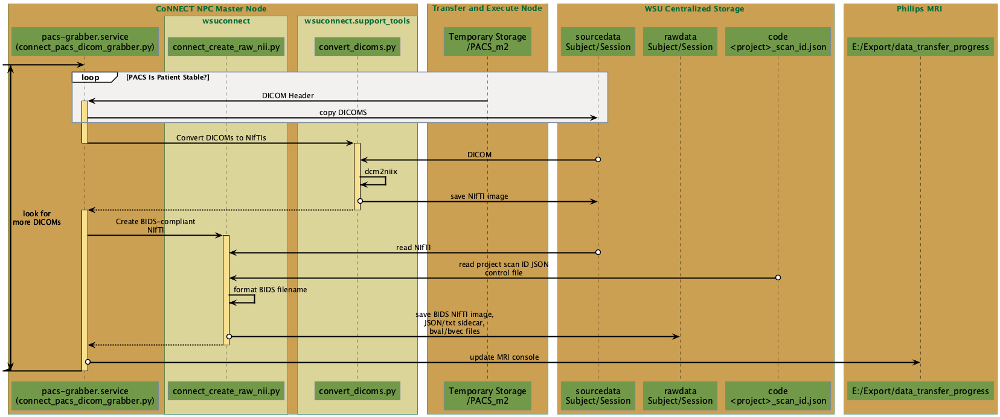
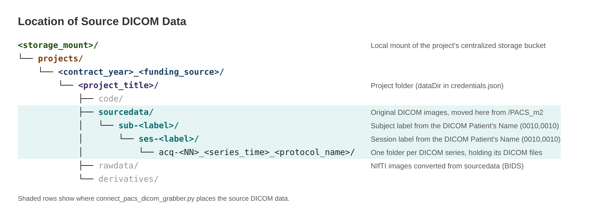
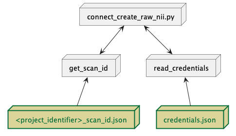

:topic: CoNNECT Broad Analysis Tools

****************************
CoNNECT Broad Analysis Tools
****************************

.. contents:: On this page
   :local:
   :depth: 1

There are many custom analysis tools that have been developed to provide broad processing capabilities across projects, MRI scanners, imaging parameters, and processing
specifications. These tools are described in this Section. Many of these tools utilize a common JSON architecture to describe project-specific inputs that are utilized
by these analysis tools to allow maximum flexibility of their implementation. Specifics of these JSON control files can be found in :ref:`json_control_files`.

.. note:: At this time, these programs only support a command-line interface (CLI). The options below are read from each program's help text (``-h``).

Project Setup
=============

Programs to add a new project and create its database tables.

.. _connect_add_project_creds_python:

connect_add_project_creds.py
----------------------------

This program requires PyQt5.

.. connect-cli:: wsuconnect.connect_add_project_creds

.. _connect_update_creds_db_python:

connect_update_creds_db.py
--------------------------

.. connect-cli:: wsuconnect.connect_update_creds_db

.. _connect_create_project_db_python:

connect_create_project_db.py
----------------------------

This program creates the Project's searchTable and searchSourceTable, as defined via the credentials JSON file loaded by :ref:`read_creds_python`.

.. connect-cli:: wsuconnect.connect_create_project_db

.. _connect_examcard_conversion_python:

connect_examcard_conversion.py
------------------------------

.. connect-cli:: wsuconnect.connect_examcard_conversion

Data Transfer and Database
==========================

Programs that move MRI data to centralized storage and keep the MySQL file tables current.

.. _connect_pacs_dicom_grabber_python:

connect_pacs_dicom_grabber.py
-----------------------------

.. _pacs_grabber_diagram:

      
   Sequence diagram for the CoNNECT PACS DICOM grabber Python function.
    

This function completes the PACS data transfer from the MRI scanner to centralized storage (see the PACS section of :doc:`Cluster Computing </cluster_computing/index>`). The MRI scanner
pushes DICOM images to the Orthanc PACS, which writes them to the temporary PACS storage location (``/PACS_m2``) on the NPC
:term:`transfer and execute node` while they are transferred. This function then moves the DICOM images from ``/PACS_m2`` to the subject/session folder in the project's ``sourcedata``
directory on the centralized storage bucket (:numref:`pacs_grabber_sourcedata_directory`), performs DICOM-to-NIfTI conversion via
:ref:`convert_dicoms.py <convert_dicoms_python>`, and moves the NIfTI images into a BIDS structure within the project's ``rawdata``
directory (:numref:`pacs_grabber_diagram`).

The <project_identifier>, subject label, and session label are extracted from the DICOM header Patient's Name (0010,0010)
attribute. These elements are space-delimited, for example ``<project_identifier> <subject_label> <session_label>``. The subject
label sets the ``sub-<label>`` folder and the session label sets the ``ses-<label>`` folder. If the Patient's Name does not include
a session label, the acquisition (study) date is used as the session label in the format YYYYMMDD (``ses-<YYYYMMDD>``). Each DICOM
series is stored in its own folder within the session folder.

.. _pacs_grabber_sourcedata_directory:

      
   Final location of source DICOM data in the project's centralized storage bucket, following transfer from the MRI via the
   Orthanc PACS and connect_pacs_dicom_grabber.py.

.. note:: This program runs continuously in the background on the CoNNECT NPC master node (and is loaded at startup) as the pacs-grabber.service. Stop the pacs-grabber.service before running it from the command line.

.. connect-cli:: wsuconnect.connect_pacs_dicom_grabber

.. _connect_neuro_db_update_python:

connect_neuro_db_update.py
--------------------------

This program searches the project directories to update the main (:ref:`searchTable <read_creds_python>`)
and/or source (:ref:`searchSourceTable <read_creds_python>`) MySQL database tables associated with the specified project.

.. note:: This program runs nightly. Run it after new files are created.

.. connect-cli:: wsuconnect.connect_neuro_db_update

.. _connect_neuro_db_query_python:

connect_neuro_db_query.py
-------------------------

This program queries the Project's MySQL :ref:`searchTable or searchSourceTable <read_creds_python>` using the search criteria defined below.

.. connect-cli:: wsuconnect.connect_neuro_db_query

BIDS Rawdata
============

Programs that build and check a project's BIDS rawdata directory.

.. _connect_dcm2nii_python:

connect_dcm2nii.py
------------------

This program converts DICOM images to NIfTI images using dcm2niix and :ref:`convert_dicoms_python`. Files within the identified Project's :ref:`searchSourceTable <read_creds_python>`
are queried via MySQL for DICOM images. These DICOM images are contained within the Project's sourcedata directory. Directories within sourcedata that contain DICOM images are then passed to dcm2niix for
conversion. The NIfTI images created are then stored in the same sourcedata directory as their source DICOM directory.

.. seealso::
    `dcm2niix <https://www.nitrc.org/plugins/mwiki/index.php/dcm2nii:MainPage>`_ is the most common tool for DICOM-to-NIfTI conversion, and is implemented on our Ubuntu 24.04 CoNNECT NPC nodes.

.. connect-cli:: wsuconnect.connect_dcm2nii

.. _connect_create_raw_nii_python:

connect_create_raw_nii.py
-------------------------

This program moves NIfTI images in sourcedata (and their sidecar JSON and text files) created by :ref:`connect_dcm2nii_python` or :ref:`convert_dicoms_python` to the corresponding rawdata directory.

.. _project_code_directory:

   Required prerequisite files for execution of connect_create_raw_nii.py.

.. connect-cli:: wsuconnect.connect_create_raw_nii

.. _connect_add_sidecar_key_python:

connect_add_sidecar_key.py
--------------------------

.. connect-cli:: wsuconnect.connect_add_sidecar_key

.. _connect_mod_sidecar_key_python:

connect_mod_sidecar_key.py
--------------------------

.. connect-cli:: wsuconnect.connect_mod_sidecar_key

.. _connect_rename_rawdata_python:

connect_rename_rawdata.py
-------------------------

.. connect-cli:: wsuconnect.connect_rename_rawdata

.. _connect_rawdata_check_python:

connect_rawdata_check.py
------------------------

This program creates a table indicating the absence (0) or presence (1) of MRI raw data (NIfTI images) in rawdata. Raw data are identified via the project's
:ref:`scan ID JSON control file <scan_id_json>`. An output table in CSV format is created in the Project's 'processing_logs' directory titled
<project_identifier>_rawdata_check.csv.

.. connect-cli:: wsuconnect.connect_rawdata_check

.. _connect_derivatives_check_python:

connect_derivatives_check.py
----------------------------

.. connect-cli:: wsuconnect.connect_derivatives_check

Logs and Scan Time
==================

Programs that collect experiment logs, MRI system logs and physiological recordings, and report scan time.

.. _connect_exp_log_grabber_p1_python:

connect_exp_log_grabber_p1.py
-----------------------------

.. note:: This program runs on the MRI stimulus computer, not on the CoNNECT NPC.

.. connect-cli:: wsuconnect.connect_exp_log_grabber_p1

.. _connect_exp_log_grabber_p2_python:

connect_exp_log_grabber_p2.py
-----------------------------

.. connect-cli:: wsuconnect.connect_exp_log_grabber_p2

.. _connect_mri_system_log_grabber_python:

connect_mri_system_log_grabber.py
---------------------------------

.. connect-cli:: wsuconnect.connect_mri_system_log_grabber

.. _connect_mri_system_log_grabber_p2_python:

connect_mri_system_log_grabber_p2.py
------------------------------------

.. connect-cli:: wsuconnect.connect_mri_system_log_grabber_p2

.. _connect_physio_extraction_python:

connect_physio_extraction.py
----------------------------

.. connect-cli:: wsuconnect.connect_physio_extraction

.. _connect_scantime_evaluator_python:

connect_scantime_evaluator.py
-----------------------------

.. connect-cli:: wsuconnect.connect_scantime_evaluator

Processing Pipelines
====================

Programs that run preprocessing and analysis pipelines, most of which can submit jobs to HTCondor.

.. _connect_aslprep_python:

connect_aslprep.py
------------------

.. connect-cli:: wsuconnect.connect_aslprep

.. _connect_fmriprep_python:

connect_fmriprep.py
-------------------

.. connect-cli:: wsuconnect.connect_fmriprep

.. _connect_recon-all_python:

connect_recon-all.py
--------------------

.. connect-cli:: wsuconnect.connect_recon-all

.. _connect_feat_full_firstlevel_python:

connect_feat_full_firstlevel.py
-------------------------------

.. connect-cli:: wsuconnect.connect_feat_full_firstlevel

.. _connect_flirt_python:

connect_flirt.py
----------------

.. connect-cli:: wsuconnect.connect_flirt

.. _connect_dti_preprocess_python:

connect_dti_preprocess.py
-------------------------

.. connect-cli:: wsuconnect.connect_dti_preprocess

.. _connect_dti_flirt_python:

connect_dti_flirt.py
--------------------

.. connect-cli:: wsuconnect.connect_dti_flirt

.. _connect_slicer_python:

connect_slicer.py
-----------------

.. connect-cli:: wsuconnect.connect_slicer

.. _connect_generate_stl_python:

connect_generate_stl.py
-----------------------

.. connect-cli:: wsuconnect.connect_generate_stl

.. _connect_zmap_cifti_python:

connect_zmap_cifti.py
---------------------

.. connect-cli:: wsuconnect.connect_zmap_cifti

Statistics and Quality Control
==============================

Programs that compute and combine regional statistics and quality control measures across participants.

.. _connect_compute_segstats_python:

connect_compute_segstats.py
---------------------------

.. connect-cli:: wsuconnect.connect_compute_segstats

.. _connect_compute_cifti_segstats_python:

connect_compute_cifti_segstats.py
---------------------------------

.. connect-cli:: wsuconnect.connect_compute_cifti_segstats

.. _connect_extract_segstats_python:

connect_extract_segstats.py
---------------------------

.. connect-cli:: wsuconnect.connect_extract_segstats

.. _connect_organize_segstats_python:

connect_organize_segstats.py
----------------------------

.. connect-cli:: wsuconnect.connect_organize_segstats

.. _connect_combine_cbf_qc_python:

connect_combine_cbf_qc.py
-------------------------

.. connect-cli:: wsuconnect.connect_combine_cbf_qc

.. _connect_combine_feat_mc_rms_python:

connect_combine_feat_mc_rms.py
------------------------------

.. connect-cli:: wsuconnect.connect_combine_feat_mc_rms

.. _connect_combine_fmriprep_fd_python:

connect_combine_fmriprep_fd.py
------------------------------

.. connect-cli:: wsuconnect.connect_combine_fmriprep_fd

.. _connect_split_aslprep_report_python:

connect_split_aslprep_report.py
-------------------------------

.. connect-cli:: wsuconnect.connect_split_aslprep_report

.. _connect_build_report_python:

connect_build_report.py
-----------------------

.. connect-cli:: wsuconnect.connect_build_report
