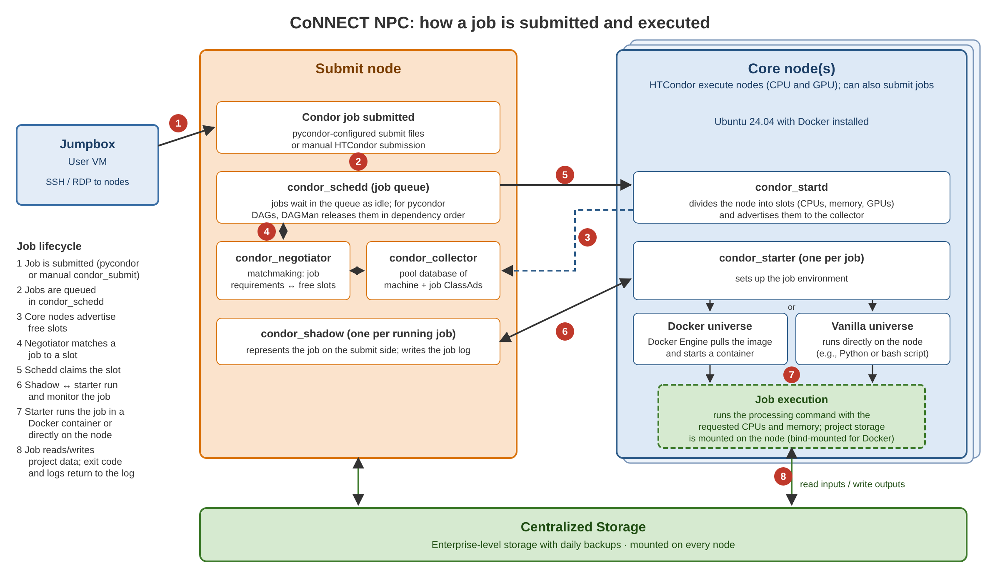

:topic: NPC

******************************
Neuro-Processing Cluster (NPC)
******************************

The CoNNECT NPC is a collection of systems that are centrally and locally managed. The resources are all centrally located and under
the control of Wright State Computing and Telecommunications (CaTS). The CoNNECT NPC operates on a network isolated from the main WSU
campus network.

**Jumpbox**

The jumpbox is a user-specific virtual machine (VM) running either Windows or Linux. The jumpbox is NIST and HIPAA compliant. A user accesses 
their jumpbox VM via VMware Horizon when connected to WSU's secure network or LAN, or connected to the network via virtual private network 
(VPN). Users can access the remainder of the CoNNECT NPC via their jumpbox.

**Master Node**

The master node is the main controller of the CoNNECT NPC. Users access the master node via secure shell (SSH) connections through their 
jumpbox. The master node has 40 physical cores and 756 GB of RAM, and runs Ubuntu 24.04. 

**Core Node(s)**

Core nodes are the workhorse of the CoNNECT NPC. The core nodes run the same operating system as the master, Ubuntu 24.04. Currently, there 
is a single core node with 40 physical cores and 756 GB of RAM. Processing can be run on the core node(s) through :term:`HTCondor` by supplying the ``--submit``
option to the programs described within this manual.

.. _npc_job_flow_figure:

   How a job is submitted and executed on the CoNNECT NPC. A job submitted through pycondor or manual HTCondor
   submission is queued by ``condor_schedd``, matched to a free slot on a core node, and run by ``condor_starter``
   either in a Docker container (docker universe) or directly on the node (vanilla universe). The job reads and
   writes project data on centralized storage.

.. include:: containerized_processing.rst

.. include:: open-source_software.rst

.. include:: MySQL_database.rst
