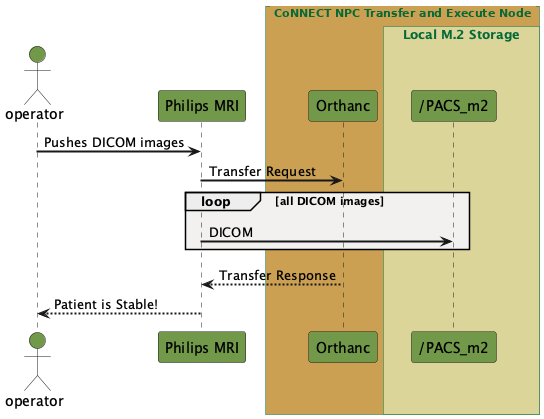

Open-Source Software
====================

Picture Archiving and Communication System (PACS)
-------------------------------------------------

`Orthanc <https://www.orthanc-server.com/>`__ is the official open-source PACS in place at the WSU CoNNECT. Using this system, which runs on the 
:doc:`master node of the CoNNECT NPC </cluster_computing/index>`, DICOM images can be sent directly from the MRI scanner to the CoNNECT NPC centralized storage.
The PACS Grabber Service then automatically detects new DICOM images arriving at the PACS storage location, moves them to the appropriate project/subject/session's sourcedata
directory, converts them to NIfTI images and stores them in the project/subject/session's rawdata directory according to the BIDS specification.

.. _orthanc_server:

      
   PACS data transfer from MRI to centralized storage via CoNNECT NPC.

Image Viewing and Analysis Software
-----------------------------------

AFNI
^^^^

AFNI is an NIH-developed suite to visualize and analyze functional MRI data.

The afni package (installed from http://neuro.debian.net/pkgs/afni.html) is located at /usr/share/afni.

AFNI is commonly utilized to overlay fMRI statistics from FSL FEAT or other output on top of T1-weighted images. Through the AFNI surface mapper (SUMA), FreeSurfer inflated surfaces 
can be used as the background image for the statistics, which can be viewed in 3D, as well as many other views. With certain datasets, this can provide powerful visuals.

.. code-block:: shell-session

    $ afni

dcm2niix
^^^^^^^^

dcm2niix is a conversion software package developed at Chris Rorden’s Neuropsychology Lab at the University of South Carolina and is distributed by the NeuroImaging Tools and Resources Collaboratory (NITRC).

A copy of dcm2niix has been compiled and placed in the scratch ‘bash’ folder, /mnt/ss_rhb1/scratch/bash. This path has been added to the system path so it can be run from any directory without the need to know the location. A copy is also in the ubuntu user download folder.

The function dcm2niix converts raw DICOM images to NIfTI (or other) formats. The function should be executed with the flags specified in Table 4.

.. code-block:: shell-session

    $ dcm2niix

FreeSurfer
^^^^^^^^^^

FreeSurfer is developed by Massachusetts General Hospital/Harvard University to analyze MRI images of the brain. The current 
version is 7.1.1; however, version 6 is installed.

The FreeSurfer package is located at /usr/share/freesurfer. This path is stored in the FREESURFER_DIR variable available 
in bash and C shell terminals. 

**Common Functions**

.. code-block:: shell-session

    $ recon-all 

Main FreeSurfer command to begin the cortical reconstruction process. The entire process takes 12-24 hours to complete.

.. code-block:: shell-session

    $ freeview

Volume and surface viewer used to assess the quality of cortical reconstruction.

FMRIB Software Library (FSL)
^^^^^^^^^^^^^^^^^^^^^^^^^^^^

The FMRIB Software Library (FSL) is a library of fMRI, MRI and DTI analysis tools developed by Oxford University, UK. The current installed version is 6.0.4. 

The FSL package is located at /usr/share/fsl/6.0. This path is stored in the FSL_DIR variable available in bash and C shell terminals.

**Common Functions**

.. code-block:: shell-session

    $ fsl

Main GUI for FSL. This GUI can be used to create individual and higher-level designs for fMRI analyses, execute individual or higher-level designs of fMRI analyses, 
run brain extraction, process DTI, perform registration, perform ICA for resting-state fMRI, or generate simulated MRI scans. 

.. seealso:: 
    Details can be found `here <https://fsl.fmrib.ox.ac.uk/fsl/fslwiki/FSL>`__. 

.. code-block:: shell-session

    $ fsleyes 

MRI visualization GUI. 

.. seealso::
    The user guide can be found `here <https://users.fmrib.ox.ac.uk/~paulmc/fsleyes/userdoc/latest/>`__.

.. code-block:: shell-session

    $ feat

Command line tool to execute fMRI design files. 

.. seealso::
    More info can be found `here <https://fsl.fmrib.ox.ac.uk/fsl/fslwiki/FEAT>`__. 

.. code-block:: shell-session

    $ randomise

Randomise (and randomise_parallel) is a non-parametric permutation inference tool for neuroimaging data. Randomise utilizes 
modelling and inferences using standard designs as used in FEAT. The main pitfall of randomise is the accommodation of correlated 
datasets (repeated measures). However, some cases of repeated measures can be accommodated. 

.. code-block:: shell-session

    $ oxford_asl

oxford_asl is a command line utility that quantifies cerebral blood flow (CBF) from arterial spin labeling (ASL) data, including 
motion-correction, registration, partial volume correction, and distortion correction. 

.. seealso::
    Command line user guide for `oxford_asl <https://asl-docs.readthedocs.io/en/latest/oxford_asl_userguide.html>`__ or  `BASIL <https://fsl.fmrib.ox.ac.uk/fsl/fslwiki/BASIL>`__,
    the GUI-based version of oxford_asl.

LCModel
^^^^^^^

.. note:: To be developed

Preprocessing Pipelines (NiPreps)
---------------------------------

The following pipelines are BIDS Apps from the `NeuroImaging PREProcessing toolS (NiPreps) <https://www.nipreps.org/>`__ community.
Each takes a valid BIDS dataset (the project's ``rawdata`` directory) as input and writes BIDS-Derivatives outputs, including an
HTML visual report for quality control of every subject. They are distributed as Docker images and are run on the CoNNECT NPC
as Docker containers, either directly or through :term:`HTCondor` (see *Containerized Processing* above).

All three pipelines use FreeSurfer, so a valid FreeSurfer license file must be passed to the container with ``--fs-license-file``.
The CoNNECT FreeSurfer license is stored in the wsuconnect package's ``licenses/`` directory
(``wsuconnect/licenses/license.txt``).

The general form of a BIDS App command is:

.. code-block:: shell-session

    $ docker run --rm \
        -v /path/to/rawdata:/data:ro \
        -v /path/to/derivatives:/out \
        -v <wsuconnect>/licenses/license.txt:/opt/freesurfer/license.txt:ro \
        <image> /data /out participant \
        --participant-label <label> \
        --fs-license-file /opt/freesurfer/license.txt

where ``<image>`` is the pipeline's Docker image, ``<label>`` is the subject label without the ``sub-`` prefix, and
``<wsuconnect>`` is the full path to the folder where the wsuconnect package is installed (Docker needs the full path for a bind mount).

sMRIPrep
^^^^^^^^

sMRIPrep (structural MRI preprocessing) is a robust, reproducible workflow for anatomical (T1-weighted, and optionally T2-weighted)
images. It performs intensity non-uniformity correction, brain extraction, tissue segmentation, spatial normalization to standard
templates, and, optionally, cortical surface reconstruction with FreeSurfer. sMRIPrep is the anatomical workflow used inside
fMRIPrep and ASLPrep, and can also be run on its own when only structural outputs are needed.

**Docker image:** ``nipreps/smriprep``

.. seealso::
    `sMRIPrep documentation <https://www.nipreps.org/smriprep/>`__

fMRIPrep
^^^^^^^^

fMRIPrep is a robust preprocessing pipeline for blood-oxygen-level-dependent (BOLD) functional MRI. It combines tools from FSL, ANTs,
FreeSurfer and AFNI to perform anatomical preprocessing (via sMRIPrep), head-motion correction, slice-timing correction,
susceptibility distortion correction using field maps, co-registration of BOLD to T1-weighted images, and resampling to standard
spaces and surfaces. It also computes confound time series (such as framewise displacement, DVARS and CompCor components) for use in
subsequent analyses. fMRIPrep performs minimal preprocessing; it does not apply spatial smoothing or denoising.

**Docker image:** ``nipreps/fmriprep``

.. seealso::
    `fMRIPrep documentation <https://fmriprep.org/en/stable/>`__

    Esteban, O., et al. (2019). fMRIPrep: a robust preprocessing pipeline for functional MRI. *Nature Methods*, 16, 111–116.

ASLPrep
^^^^^^^

ASLPrep is a preprocessing and cerebral blood flow (CBF) computation pipeline for arterial spin labeling (ASL) perfusion MRI,
built on the same framework as fMRIPrep. It performs anatomical preprocessing (via sMRIPrep), motion correction, susceptibility
distortion correction, co-registration of ASL to T1-weighted images and normalization to standard space, and computes CBF maps
using the standard single- and multi-delay models, with optional BASIL quantification and SCORE/SCRUB denoising. ASL data must be organized in the BIDS ``perf`` data type, with the
required ``aslcontext.tsv`` file and ASL metadata in the sidecar JSON.

**Docker image:** ``pennlinc/aslprep``

.. seealso::
    `ASLPrep documentation <https://aslprep.readthedocs.io/en/latest/>`__

    Adebimpe, A., et al. (2022). ASLPrep: a platform for processing of arterial spin labeled MRI and quantification of regional
    brain perfusion. *Nature Methods*, 19, 683–686.
