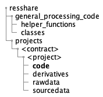

:topic: Project-Specific JSON Control Files

.. _json_control_files:

***********************************
Project-Specific JSON Control Files
***********************************

The CoNNECT custom developed support tools use JSON control files stored in each project's BIDS ``code`` directory (:numref:`project_code_directory`). 
The files are named <project_identifier>_<image_type>_<process>_input.json. Image types are listed in :numref:`input_data_types`, and available 
processes are ``flirt`` and ``bet``.

.. note::
   The image types below are CoNNECT labels used only in control file names. They are not BIDS :term:`data types <data type>`
   (such as ``anat`` or ``perf``); the corresponding BIDS :term:`suffix` is listed for reference.

.. _project_code_directory:

      
   Directory tree showing the location of a Project's JSON control files.

.. _input_data_types:

.. list-table:: Image types used in JSON control file names.
   :widths: 20 55 25
   :header-rows: 1

   * - **Image Type**
     - **Source Image Description**
     - **BIDS Suffix**
   * - struc
     - T1-weighted image
     - ``T1w``
   * - asl
     - Arterial spin labeling (ASL) or cerebral blood flow (CBF) image
     - ``asl`` (CBF maps are derivatives and have no BIDS raw-data suffix)
   * - apt
     - Amide proton transfer-weighted (APTw) source or MTRasym image
     - None (not defined in BIDS)
   * - flair
     - T2-weighted fluid-attenuated inversion recovery (FLAIR) image
     - ``FLAIR``
   * - T2
     - T2-weighted or T2*-weighted image
     - ``T2w`` or ``T2starw``

.. include:: brain_extraction.rst
.. include:: flirt_control.rst
.. include:: scan_id.rst

