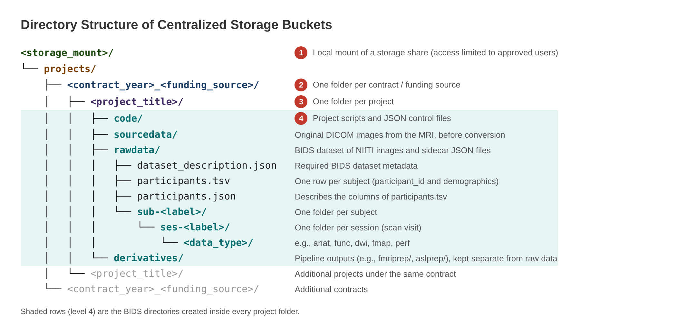

Data Management
===============

Centralized Storage
-------------------

CoNNECT data are kept on enterprise-level centralized storage with daily backups. The storage is divided into
:term:`storage buckets <storage bucket>`. Access to each bucket is limited to the approved users for the projects it holds. This is
controlled in two places: by IT on the storage side, and by the mount permissions on the CoNNECT nodes.

Each bucket is mounted on the :term:`NPC` nodes, where it appears as a local directory. This manual refers to that directory as
the :term:`storage mount` and writes it as ``<storage_mount>``.

.. _storage_directory_structure:

Directory Structure
-------------------

Every storage bucket follows the same directory structure (:numref:`storage_directory_structure_figure`):

#. ``<storage_mount>/``: the local mount of the centralized storage bucket.
#. ``projects/<contract_year>_<funding_source>/``: one folder for each contract or funding source.
#. ``<project_title>/``: one folder for each project under that contract.
#. ``code/``, ``sourcedata/``, ``rawdata/`` and ``derivatives/``: the BIDS directories inside every project folder
   (see :ref:`data_organization`).

.. _storage_directory_structure_figure:

   Directory structure of the centralized storage buckets. The shaded rows are the BIDS directories created inside every
   project folder. Inside ``rawdata``, each subject folder (``sub-<label>``) holds one folder per session (``ses-<label>``),
   and each session folder holds one folder per :term:`data type` (for example, ``anat``, ``func``, ``dwi``, ``fmap`` or ``perf``).

.. _data_organization:

Data Organization
-----------------

Data collected and produced for each project follow the `Brain Imaging Data Structure (BIDS) specification <https://bids-specification.readthedocs.io/en/stable/>`__
to uphold community standards and to improve data integrity, consistency and processing efficiency. See the :doc:`../glossary` for
definitions of the BIDS terms used throughout this manual.

Each project directory contains three top-level directories:

* ``sourcedata``: the original :term:`DICOM` images exported from the MRI, before file format conversion.
* ``rawdata``: the BIDS dataset of :term:`NIfTI` images and their :term:`sidecar JSON` files, converted from ``sourcedata``.
* ``derivatives``: outputs of processing pipelines, kept separate from the raw data.

A BIDS filename is a chain of :term:`entities <entity>` separated by underscores, followed by a :term:`suffix` and a
:term:`file extension`. Each entity is a key-value pair written as ``<key>-<value>``. Entities MUST appear in the order defined by the
`BIDS entity table <https://bids-specification.readthedocs.io/en/stable/appendices/entity-table.html>`__, and optional entities
are left out when they are not needed. For example:

.. code-block:: text

    sub-<label>[_ses-<label>][_task-<label>][_acq-<label>][_dir-<label>][_run-<index>]_<suffix>.<extension>

    sub-001_ses-01_task-rest_run-01_bold.nii.gz

.. _get_bids_filename_table:

.. list-table:: Entities supported by get_bids_filename, in BIDS order.
   :widths: 20 20 60
   :header-rows: 1

   * - **Entity**
     - **Key**
     - **Description**
   * - subject
     - sub
     - A person or animal participating in the study. Required in every filename.
   * - session
     - ses
     - A logical grouping of neuroimaging and behavioral data consistent across subjects.
   * - task
     - task
     - A set of structured activities performed by the participant. No two tasks should have the same label.
   * - acquisition
     - acq
     - A custom label the user may use to distinguish a different set of parameters used for acquiring the same modality,
       such as ``acq-highres`` or ``acq-lowres``.
   * - direction
     - dir
     - The phase-encoding direction, used to distinguish otherwise identical images acquired with different phase-encoding
       directions, such as ``dir-AP`` or ``dir-PA``.
   * - run
     - run
     - An index that distinguishes separate data acquisitions with the same acquisition parameters and task within the same session.
   * - processed
     - proc
     - A variant of a file that was a result of particular processing performed on the device (the MRI scanner).
   * - space
     - space
     - The coordinate system for interpreting spatial coordinates, such as ``space-MNI152NLin2009cAsym`` for a standard-space template.
   * - resolution
     - res
     - The resolution of regularly sampled N-dimensional data. Used only in derivatives.
   * - description
     - desc
     - Distinguishes two files that do not otherwise have a distinguishing entity, such as ``desc-brain`` for a brain-extracted image.
       Used only in derivatives.
   * - suffix
     - N/A
     - The alphanumeric string after all entities and the final underscore, usually indicating the modality, such as ``T1w`` or ``bold``.
   * - extension
     - N/A
     - The portion of the filename after the left-most period, such as ``.nii.gz`` or ``.json``. Depends on the modality and data format.
