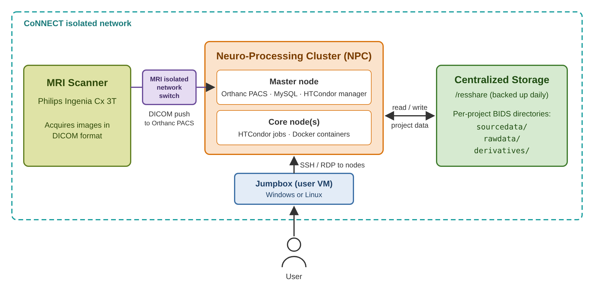

:topic: Systems Overview

****************
Systems Overview
****************

.. contents:: On this page
   :local:
   :depth: 2

The CoNNECT MRI facility consists of several components described below.

.. _systems_overview_figure:

   Overview of the CoNNECT systems. The MRI scanner, the NPC master node and the NPC transfer and execute node share the
   MRI scanner's isolated network switch, over which the scanner pushes DICOM images to the Orthanc PACS on the transfer and
   execute node. The :term:`NPC` stores project data in BIDS directories on centralized storage. Users reach the NPC
   nodes over SSH or RDP from their :term:`jumpbox`.

.. include:: mri.rst

.. include:: data_storage.rst

.. include:: connect_npc.rst
